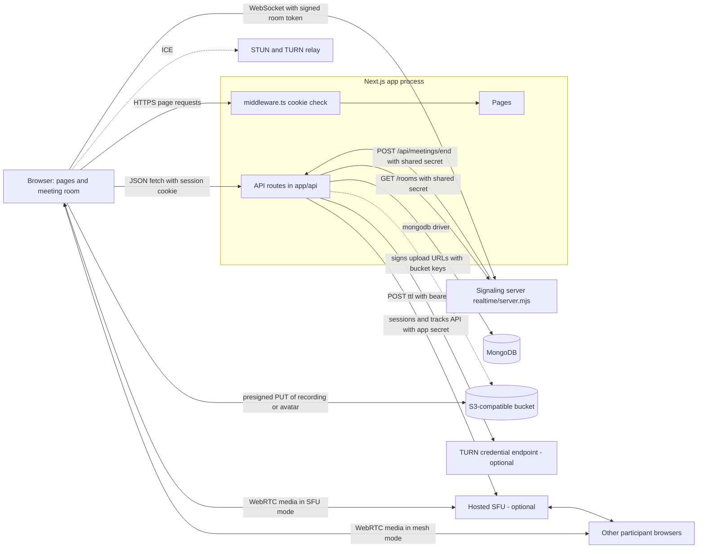
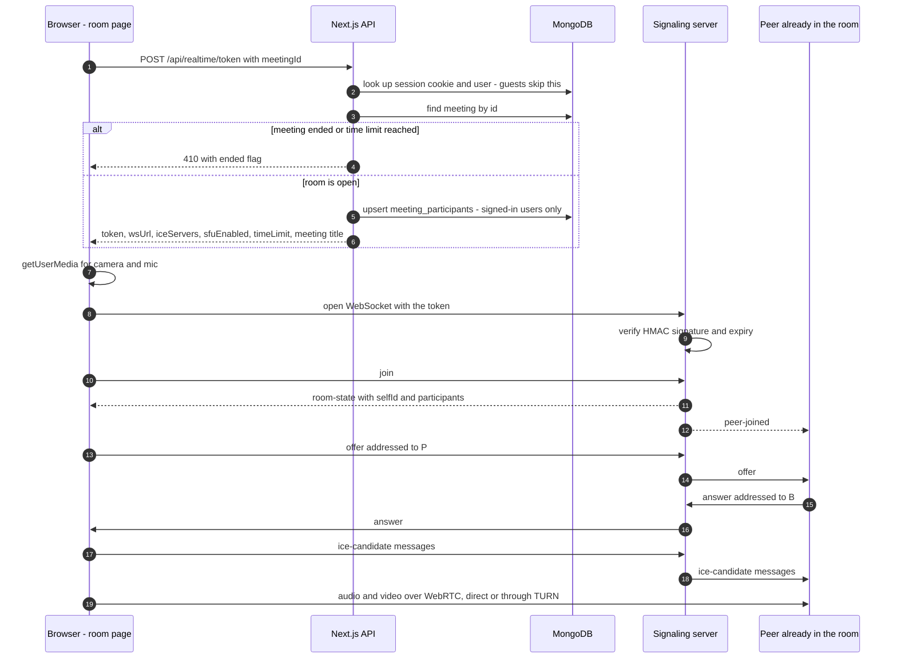
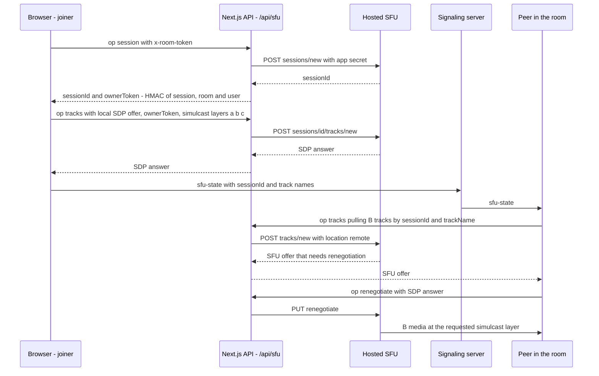

# Architecture

Meet is a browser meeting app built from two long-running Node processes and a
few outside services:

1. **The Next.js app** (`app/`, `lib/`, `types/`, `middleware.ts`): the pages,
   the JSON API, sign-in, and everything that touches MongoDB.
2. **The signaling server** (`realtime/server.mjs`): a small WebSocket server
   that introduces browsers to each other, relays chat, and knows which rooms
   are live. It keeps rooms in memory and has its own `package.json`, so it can
   be deployed on its own.

Media (camera, microphone, screen) never passes through either process. It
travels over WebRTC, either directly between browsers (mesh) or through an
optional hosted SFU.

## The parts

| Part | Where | What it does |
| --- | --- | --- |
| Pages | `app/page.tsx`, `app/dashboard.tsx`, `app/components/*`, `app/{login,signup,meetings,recordings,contacts,profile}/page.tsx` | Landing page for visitors, the dashboard for signed-in users, sign-in and sign-up forms. |
| Meeting room | `app/room/[meetingId]/page.tsx` | Camera, mic, screen share, chat, layouts, recording, invites. Open to signed-out guests. |
| Browser libraries | `lib/client-api.ts`, `lib/sfu-client.ts`, `lib/e2ee.ts`, `lib/format.ts` | JSON fetch helper, the SFU session in the browser, frame encryption for encrypted rooms. |
| Route guard | `middleware.ts`, `lib/session.ts` | Redirects to `/login` when the session cookie is missing on `/meetings`, `/recordings`, `/contacts`, `/profile`. It checks only that the cookie exists; the API checks that it is valid. |
| API route handlers | `app/api/**/route.ts`, wrapped by `apiHandler` in `lib/api.ts` | Accounts, meetings, calls, contacts, notifications, profile, workspaces, room tokens, the SFU proxy, recordings, upload signing. |
| Server libraries | `lib/auth.ts`, `lib/mongodb.ts`, `lib/meetings.ts`, `lib/workspace-scope.ts`, `lib/realtime-token.ts`, `lib/realtime-presence.ts`, `lib/turn.ts`, `lib/sfu.ts`, `lib/storage.ts`, `lib/logger.ts`, `lib/demo-data.ts` | Sessions, the database client, shared queries, token signing, outside-service clients, JSON logging. |
| Signaling server | `realtime/server.mjs` | WebSocket rooms, SDP and ICE relay, chat relay, presence list at `GET /rooms`, auto-ending empty rooms. |
| Database | MongoDB through the official `mongodb` driver (no ORM) | Seven collections: `users`, `sessions`, `meetings`, `meeting_participants`, `call_invites`, `recordings`, `workspaces`. See [SYSTEM-DESIGN.md](SYSTEM-DESIGN.md). |
| File storage | Any S3-compatible bucket | Recordings and profile pictures, uploaded by the browser with presigned `PUT` URLs. |
| Network relays | A STUN server, plus TURN (a credential endpoint or a static server) | Lets browsers find a media path. Without TURN, calls fail on many home and mobile networks. |
| SFU (optional) | Any hosted SFU with the sessions/tracks HTTPS API described in `lib/sfu.ts` | One connection per participant instead of a mesh, with three simulcast layers. |

There are **no payments**, no email sending, no background job queue and no
third-party sign-in. Each item in that list is simply absent from the code.

## How the parts talk

Five rules hold the picture together:

- **The app never holds media.** Recordings and avatars go from the browser
  straight to the bucket. Camera and mic go from browser to browser, or browser
  to SFU. The one exception: without storage, an avatar is saved as a small
  inline image on the user document.
- **The app and the signaling server share one secret, `REALTIME_SECRET`.** The
  app signs room tokens with it. The signaling server checks them. Both sides
  also send it in an `x-realtime-secret` header when they call each other.
- **Outside-service secrets stay on the server.** These are the bucket keys,
  `TURN_API_TOKEN` and `REALTIME_SFU_APP_SECRET`. Browsers get presigned URLs,
  short-lived TURN credentials, and `/api/sfu` as a proxy instead.
- **Nothing pushes to the dashboard.** It polls. Incoming calls are checked
  every 5 s, recent meetings every 15 s and notifications every 20 s.
- **Missing MongoDB means demo mode.** Without `MONGODB_URI`, `getDatabase()`
  returns `null`. Routes that need a user answer 401, because no account can
  exist. Guest room links still work.

## Pages

| Path | File | Who can open it | What it shows |
| --- | --- | --- | --- |
| `/` | `app/page.tsx` | Anyone | The landing page (`app/components/landing.tsx`) when there is no session cookie, otherwise the Overview dashboard (`app/dashboard.tsx`). |
| `/meetings` | `app/meetings/page.tsx` | Session cookie (middleware) | Dashboard "My meetings" view. |
| `/recordings` | `app/recordings/page.tsx` | Session cookie | Recordings list with an in-app player. |
| `/contacts` | `app/contacts/page.tsx` | Session cookie | People you have shared a room with, with a call button. |
| `/profile` | `app/profile/page.tsx` | Session cookie | Name, username, password, profile picture, usage stats. |
| `/login` | `app/login/page.tsx` | Anyone | Username and password, plus "Keep me signed in". |
| `/signup` | `app/signup/page.tsx` | Anyone | Name, username, password. |
| `/room/[meetingId]` | `app/room/[meetingId]/page.tsx` | Anyone with the link, guests included | The meeting room. |
| `/manifest.webmanifest` | `app/manifest.ts` | Anyone | The install manifest. `app/components/install-prompt.tsx` shows the install prompt. There is no service worker. |

The dashboard pages are a single client component, `app/dashboard.tsx`,
rendered with a different `view` prop. When `/api/auth/me` answers 401 (for
example, the cookie is present but the session has expired), the dashboard
sends the browser to `/login`.

## API routes

Every handler is wrapped in `apiHandler` (`lib/api.ts`). That wrapper turns a
thrown `ApiError` into `{ error }` with its status, and anything else into a
logged, generic 500.

| Method and path | File | Who may call it | Data it touches |
| --- | --- | --- | --- |
| `POST /api/auth/register` | `app/api/auth/register/route.ts` | Anyone | `users` (unique index on `username`), `sessions` |
| `POST /api/auth/login` | `app/api/auth/login/route.ts` | Anyone | `users`, `sessions` |
| `POST /api/auth/logout` | `app/api/auth/logout/route.ts` | Anyone (deletes the current session if present) | `sessions` |
| `GET /api/auth/me` | `app/api/auth/me/route.ts` | Anyone; 401 with `{ user: null }` when signed out | `sessions`, `users` |
| `GET /api/meetings` | `app/api/meetings/route.ts` | Signed-in user | `meeting_participants`, `workspaces`, `meetings` |
| `POST /api/meetings` | `app/api/meetings/route.ts` | Signed-in user | `meetings` |
| `GET /api/meetings/recent` | `app/api/meetings/recent/route.ts` | Signed-in user | `meeting_participants`, `workspaces`, `meetings`, signaling `GET /rooms` |
| `POST /api/meetings/end` | `app/api/meetings/end/route.ts` | The meeting owner, or the signaling server with `x-realtime-secret` | `meetings` |
| `GET /api/calls` | `app/api/calls/route.ts` | Signed-in user | `call_invites` |
| `POST /api/calls` | `app/api/calls/route.ts` | Signed-in user. Ringing someone into an existing room requires owning it or having joined it. | `users`, `meetings`, `meeting_participants`, `call_invites` |
| `PATCH /api/calls/[callId]` | `app/api/calls/[callId]/route.ts` | The callee (accept, decline) or the caller (cancel) | `call_invites` |
| `GET /api/contacts` | `app/api/contacts/route.ts` | Signed-in user | `meeting_participants`, `meetings`, `workspaces`, `users` |
| `GET /api/notifications` | `app/api/notifications/route.ts` | Signed-in user | `call_invites`, `meetings`, `meeting_participants`, `recordings`, signaling `GET /rooms` |
| `GET /api/profile` | `app/api/profile/route.ts` | Signed-in user | `meeting_participants`, `meetings`, `recordings` |
| `PATCH /api/profile` | `app/api/profile/route.ts` | Signed-in user; a password change needs the current password | `users` |
| `GET /api/workspaces` | `app/api/workspaces/route.ts` | Signed-in user; creates a default "Personal" workspace on first call | `workspaces` |
| `POST /api/workspaces` | `app/api/workspaces/route.ts` | Signed-in user | `workspaces` |
| `PATCH /api/workspaces/[workspaceId]` | `app/api/workspaces/[workspaceId]/route.ts` | The workspace owner | `workspaces` |
| `DELETE /api/workspaces/[workspaceId]` | `app/api/workspaces/[workspaceId]/route.ts` | The workspace owner, unless it is their last workspace | `workspaces`, `meetings`, `recordings` |
| `POST /api/realtime/token` | `app/api/realtime/token/route.ts` | Anyone, guests included | `meetings`, `meeting_participants`, TURN credential endpoint |
| `POST /api/sfu` | `app/api/sfu/route.ts` | Holder of a valid room token (`x-room-token` header); changing a session also needs that session's owner token | Hosted SFU only |
| `GET /api/recordings` | `app/api/recordings/route.ts` | Signed-in user | `workspaces`, `recordings` |
| `POST /api/recordings` | `app/api/recordings/route.ts` | Signed-in user | `meetings`, `recordings` |
| `POST /api/uploads/sign` | `app/api/uploads/sign/route.ts` | Signed-in user | None. It signs a bucket URL locally. |

## The signaling server

`realtime/server.mjs` is one `http` server with a `ws` WebSocket server on top.

- **HTTP:** `GET /rooms` returns `{ rooms: { [roomId]: participantCount } }`.
  It only answers callers that send the shared secret, because room ids are
  invite links. Any other path returns 404.
- **WebSocket:** the browser connects with `?token=<room token>`. A bad or
  expired token is closed with code 1008. A connection only joins its room
  after it sends `join`.

| Client sends | Server does |
| --- | --- |
| `join` | Adds the peer to the room. Sends `room-state` (your `selfId` and the people already there) to the joiner and `peer-joined` to everyone else. Cancels any pending auto-end. |
| `offer`, `answer`, `ice-candidate` with `to` and `payload` | Relays to that peer if they are in the same room. |
| `chat` with `text` and optional `to` | Trims to 1000 characters, stamps an id and time, and broadcasts it. When `to` is set, sends a private copy to the target and the sender only. Nothing is stored. |
| `screen-share`, `av-state` | Broadcasts presenter and camera/mic state to the others. |
| `sfu-state` with `sessionId` and `tracks` | Rebuilds the shape (at most 8 tracks, names cut to 64 characters) and broadcasts it, so others can pull this peer's media from the SFU. |
| `encrypted-restart` | Broadcasts it. Receivers stop their media and are told to get the new encrypted link. |
| `leave`, or the socket closes | Removes the peer and sends `peer-left`. If the room is now empty, schedules a call to `POST /api/meetings/end` after `AUTO_END_MINUTES`. |

Messages over 64 KB, and anything that is not JSON, are dropped.

## The main request: joining a room

This is the path every call takes. The diagram shows mesh mode, which is used
when no SFU is configured.

The newcomer always makes the offers. Everyone already in the room answers.

### SFU mode

When `REALTIME_SFU_API_URL`, `REALTIME_SFU_APP_ID` and
`REALTIME_SFU_APP_SECRET` are all set, the token response carries
`sfuEnabled: true`. The room then switches to one SFU connection per browser
(`lib/sfu-client.ts`):

Only the browser that created an SFU session can push to it, pull into it,
renegotiate it, close it or change its layers. Every such call must present the
owner token from `signSfuOwner` in `lib/sfu.ts`. Pulling someone else's tracks
needs only their public `sessionId` and track names, which `sfu-state` carries.

In an encrypted room (`#k=` in the link) every frame is AES-GCM encrypted in the
browser before it reaches the SFU (`lib/e2ee.ts`). In mesh mode the room relies
on WebRTC's own DTLS-SRTP between the two browsers.

## Sign-in

- Accounts are a username and a bcrypt password hash. There is no email and no
  third-party sign-in. The "Forgot password?" link only shows a message;
  password reset is not built.
- Signing in creates a random token in `sessions` (30-day TTL) and sets the
  HTTP-only cookie `converge_session` (`SameSite=Lax`, `Secure` in production).
  With "Keep me signed in" unchecked, the cookie has no expiry, so it ends when
  the browser closes.
- Server code reads the user with `getCurrentUser()` (`lib/auth.ts`). Routes
  that need a user call `requireUser()` (`lib/api.ts`).
- Guests in a room get a token with `userId` set to `guest-<random>` and the
  name "Guest User". Nothing is written to the database for them.

## Storage

`lib/storage.ts` builds an S3 client from the `STORAGE_*` variables. Its region
is `auto` and its endpoint is configurable. `POST /api/uploads/sign` returns a
presigned `PUT` URL valid for 15 minutes, for one of these keys:

- `recordings/<ownerId>/<YYYY-MM-DD>/<uuid>-<filename>`
- `avatars/<ownerId>/<YYYY-MM-DD>/<uuid>-avatar.jpg`

Files are played back from `STORAGE_PUBLIC_URL/<key>`. When storage is not
configured, the route answers `{ configured: false }`. Profile pictures then
fall back to a small inline `data:` image stored on the user document.
Recordings cannot be saved without storage.

## Outside services

| Service | Needed? | Configured by | Used from |
| --- | --- | --- | --- |
| MongoDB | Needed for accounts. Without it, only guest rooms work. | `MONGODB_URI`, `MONGODB_DB` (default `converge`) | `lib/mongodb.ts` |
| S3-compatible bucket | Needed for recordings; optional for avatars | `STORAGE_BUCKET`, `STORAGE_ACCESS_KEY_ID`, `STORAGE_SECRET_ACCESS_KEY`, `STORAGE_ENDPOINT`, `STORAGE_PUBLIC_URL` | `lib/storage.ts`, browser `PUT` |
| STUN | Defaults to a public STUN server | `NEXT_PUBLIC_STUN_URL` | `app/api/realtime/token/route.ts` |
| TURN | Strongly recommended | `TURN_CREDENTIALS_URL` and `TURN_API_TOKEN`, or `NEXT_PUBLIC_TURN_URL`, `NEXT_PUBLIC_TURN_USERNAME`, `NEXT_PUBLIC_TURN_PASSWORD` | `lib/turn.ts` |
| Hosted SFU | Optional | `REALTIME_SFU_API_URL`, `REALTIME_SFU_APP_ID`, `REALTIME_SFU_APP_SECRET` | `lib/sfu.ts` |

Other settings: `REALTIME_SECRET` (both processes), `REALTIME_WS_URL` (app),
`REALTIME_PORT` or `PORT` (signaling), `APP_URL` and `AUTO_END_MINUTES`
(signaling), `MEETING_TIME_LIMIT_MINUTES` (app), and `LOG_LEVEL` (app; the
signaling server ignores it). `.env.example` lists them all.

## Logging

The app logs one JSON line per event through `lib/logger.ts`, with `time`,
`level`, `scope`, `message` and context. Keys that look like secrets are
replaced with `<redacted>`. Credentials inside URLs are stripped. The signaling
server writes the same shape, so `npm run dev` reads as one stream.
