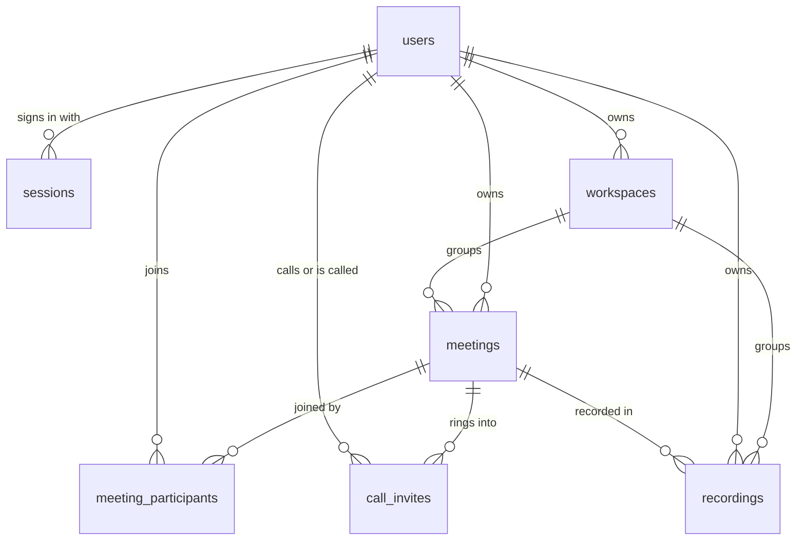

# System design

This page describes how Meet stores its data, how its main flows run, who may
do what, its limits, how it handles failure, how it is secured, and how it
scales. Every number comes from the code; the file that sets it is named.
[ARCHITECTURE.md](ARCHITECTURE.md) has the parts and the diagrams.

## Data model

MongoDB is reached through the official driver (`lib/mongodb.ts`). There is no
ORM and no schema enforced by the database. The TypeScript types below are the
schema. The database name is `MONGODB_DB`, which defaults to `converge`. Ids
that the app generates are `crypto.randomUUID()` strings stored in an `id`
field, next to Mongo's own `_id`. The exceptions are users and sessions, which
use `_id`.

### `users`: type `UserDocument` in `lib/auth.ts`

| Field | Type | Notes |
| --- | --- | --- |
| `_id` | ObjectId | The user id. Other collections store it as a string. |
| `name` | string | Trimmed, 2 to 80 characters. |
| `username` | string | Lower-cased, leading `@` removed, must match `^[a-z0-9._-]{3,24}$`. |
| `passwordHash` | string | bcrypt with cost 12 (`PASSWORD_ROUNDS`). |
| `avatarUrl` | string, optional | An `http(s)` URL, or an inline `data:image/...` URL of at most 400,000 characters. |
| `createdAt` | Date | |

Index: `{ username: 1 }`, unique. `POST /api/auth/register` creates it on
every call.

### `sessions`: inline type in `lib/auth.ts`

| Field | Type | Notes |
| --- | --- | --- |
| `_id` | ObjectId | Generated by Mongo. |
| `token` | string | `crypto.randomUUID()`. This is also the value of the `converge_session` cookie. |
| `userId` | ObjectId | Points to `users._id`. |
| `expiresAt` | Date | Now plus 30 days. |
| `createdAt` | Date | |

Index: `{ expiresAt: 1 }` with `expireAfterSeconds: 0`, so MongoDB deletes
expired sessions on its own. `createSession` creates the index on every
sign-in.

### `meetings`: type `Meeting` in `types/meeting.ts`, built by `buildMeeting` in `lib/meetings.ts`

| Field | Type | Notes |
| --- | --- | --- |
| `id` | string (UUID) | The room id in `/room/[meetingId]`. |
| `ownerId` | string, optional | The creator's user id. Always set by `buildMeeting`. |
| `workspaceId` | string, optional | The workspace it belongs to. Missing means the owner's default workspace. |
| `roomName` | string, optional | `converge-<uuid>`. Written, but no code reads it. |
| `title` | string | Up to 200 characters when scheduled. Direct calls are titled "First × First". |
| `dateLabel`, `timeLabel` | string | en-US labels made when the meeting is created, in the server's time zone. The dashboard re-formats from `dateTime`. |
| `dateTime` | string (ISO) | The start time. |
| `duration` | string | Default `"30 min"`. Stored as sent, with no validation. |
| `type` | `"Design review"` \| `"Weekly sync"` \| `"Client call"` \| `"Planning"` | Default `"Planning"`. Not validated on `POST`. |
| `attendees` | string[] | Initials of the people on the invite. |
| `attendeeCount` | number | |
| `status` | `"upcoming"` \| `"live"` \| `"ended"` | Scheduled and instant meetings start as `upcoming`, direct calls as `live`. Only `/api/meetings/end` changes it, and only to `ended`. "Live" on the dashboard comes from signaling presence, not from this field. |
| `createdAt` | string (ISO), optional | |
| `endedAt` | string (ISO), optional | |
| `endedReason` | string, optional | `"empty"` when the signaling server ends it, otherwise the reason sent, or `"manual"`. |

### `meeting_participants`: type `ParticipantDocument` in `types/db.ts`

| Field | Type | Notes |
| --- | --- | --- |
| `meetingId` | string | Points to `meetings.id`. It can also be an ad-hoc room id with no stored meeting. |
| `userId` | string | Points to `users._id`. |
| `name`, `username` | string | A snapshot taken at join time. |
| `joinedAt` | string (ISO) | Overwritten every time this user gets a room token. |

Written only by `POST /api/realtime/token`, as an upsert on
`(meetingId, userId)`, and only for signed-in users. This collection powers
contacts, "recent meetings", notifications, profile stats and the
meeting-time-limit clock.

### `call_invites`: type `CallInvite` in `types/call.ts`

| Field | Type | Notes |
| --- | --- | --- |
| `id` | string (UUID) | |
| `meetingId` | string | The room the callee is rung into. |
| `fromUserId`, `fromName`, `fromUsername` | string | The caller. |
| `toUserId`, `toName` | string | The callee. |
| `status` | `"ringing"` \| `"accepted"` \| `"declined"` \| `"cancelled"` | |
| `createdAt` | string (ISO) | |

"Missed" is not a stored status. It is an invite still `ringing` after
`RING_WINDOW_MS` (45 seconds, `types/call.ts`).

### `recordings`: type `RecordingDocument` in `types/db.ts`

| Field | Type | Notes |
| --- | --- | --- |
| `id` | string (UUID) | |
| `ownerId` | string | The user who recorded and uploaded it. |
| `provider` | `"storage"` | Always the app's S3-compatible bucket. |
| `filename` | string | Up to 200 characters. |
| `contentType` | string | `video/webm` from the room page. |
| `size` | number | Bytes, more than 0 and at most 10 GiB. |
| `key` | string | The bucket object key. Typed optional, but `POST` requires it. |
| `publicUrl` | string, optional | Must be `https`, and must sit under `STORAGE_PUBLIC_URL` when that is set. |
| `meetingId` | string, optional | |
| `workspaceId` | string, optional | Taken from the meeting's workspace, otherwise from the request. |
| `createdAt` | string (ISO) | |

### `workspaces`: type `Workspace` in `types/workspace.ts`

| Field | Type | Notes |
| --- | --- | --- |
| `id` | string (UUID) | |
| `name` | string | Trimmed, 1 to 60 characters. |
| `ownerId` | string | |
| `isDefault` | boolean | `true` for the "Personal" workspace created on a user's first `GET /api/workspaces`. |
| `createdAt` | string (ISO) | |

### State that is not in MongoDB

| What | Where it lives |
| --- | --- |
| Who is in which room right now | Memory of the signaling server (`rooms` and `clients` maps in `realtime/server.mjs`) |
| Chat messages | Nowhere. They are relayed live and lost when the room empties. |
| SFU sessions and tracks | The hosted SFU. Ownership is proven by a stateless HMAC, not stored. |
| Recording and avatar files | The S3-compatible bucket |
| The end-to-end encryption key | The `#k=` URL fragment, in browsers only |
| Active workspace, camera and mic preferences | Browser `localStorage` keys `converge_active_workspace` and `converge_av_preferences` |

## Main flows

### Sign up, sign in, sign out

1. `POST /api/auth/register` validates the name, username and password, and
   checks that the two passwords match. It then requires the database, ensures
   the unique `username` index, rejects a taken username with 409, and inserts
   the user with a bcrypt hash.
2. `createSession` inserts a session and `attachSessionCookie` sets
   `converge_session`.
3. `POST /api/auth/login` normalises the username, compares the password with
   bcrypt, and does the same as step 2. With `remember: false` the cookie has
   no expiry.
4. `POST /api/auth/logout` deletes the session document and the cookie.

### Start or schedule a meeting

1. The dashboard posts to `/api/meetings`. An instant meeting has `dateTime`
   set to now and the title "Instant team meeting". A scheduled one uses the
   picked time converted to ISO.
2. The route builds the document with `buildMeeting` and inserts it with
   status `upcoming`.
3. An instant meeting sends the browser straight to `/room/<id>`. A scheduled
   one appears in the list. "Copy link" copies `<origin>/room/<id>`.

### Join a room

1. The room page posts `{ meetingId }` to `/api/realtime/token`. No sign-in is
   needed.
2. The route answers 410 when the stored meeting is `ended` or its time limit
   has passed. Otherwise it upserts the participant row (signed-in users only)
   and signs a 6-hour room token: `base64url(JSON claims) + "." + HMAC-SHA256`.
   It returns `iceServers`, which are STUN plus TURN from `lib/turn.ts`,
   along with `sfuEnabled` and `timeLimit`.
3. The browser asks for camera and mic with echo cancellation, noise
   suppression and auto gain on. If that fails it falls back to video only,
   then audio only, then an empty stream.
4. **Mesh mode:** the browser opens the WebSocket, sends `join`, gets
   `room-state`, and creates one `RTCPeerConnection` per existing participant.
   The newcomer sends the offers. Every connection always negotiates one audio
   and one video slot, so a device with no camera can still receive.
5. **SFU mode:** in parallel with the socket, `SfuSession.connect` creates an
   SFU session through `/api/sfu` and pushes local tracks. Video is pushed with
   three simulcast layers: `a` at 1.2 Mbps, `b` at 400 kbps and half
   resolution, `c` at 120 kbps and quarter resolution. Once both the socket
   and the push are ready, the browser broadcasts `sfu-state`. Each receiver
   pulls those tracks, first at layer `a` (`b` once it is already pulling two
   or more peers). Every SDP change goes through one serial queue.
6. Every 400 ms the page samples audio levels for the active-speaker
   highlight. A speaker stays highlighted for 1.2 s after their last loud
   sample. Spotlight order is: your own screen share, then a remote presenter,
   then the most recent speaker, then the first participant. In SFU mode the
   featured tile asks for layer `a` and spotlight thumbnails ask for `c`. In
   grid view a tile asks for `a` when that peer is presenting or there are at
   most two remote peers, and `b` otherwise.

### Direct call and ringing

1. From Contacts, `POST /api/calls { toUserId }` creates a new `live` meeting
   titled "First × First" and a `ringing` invite. The caller goes straight
   into the room.
2. The callee's dashboard polls `GET /api/calls` every 5 seconds. It shows
   invites that are still ringing and less than 45 seconds old.
3. Accept sends `PATCH /api/calls/<id> { action: "accept" }` and opens the
   room. Decline sets `declined`. The API also lets the caller send `cancel`,
   but the UI never calls it.
4. An invite that is never answered stays `ringing`. After 45 seconds it drops
   out of `GET /api/calls`, and for 24 hours `GET /api/notifications` lists it
   as a missed call.
5. Inside a room, the Invite panel can ring a contact into the current room
   with `POST /api/calls { toUserId, meetingId }`. This is allowed only for
   the meeting owner or someone who has joined it. It is hidden in encrypted
   rooms, because ringing would bring the contact in without the key.

### Record a meeting

1. The recorder's browser draws every visible tile onto a 1280×720 canvas
   every 100 ms. It captures that canvas at 30 fps and mixes every audio track
   through an `AudioContext`. `MediaRecorder` writes WebM (VP8 and Opus where
   supported) at 2.5 Mbps.
2. When recording stops, the page asks `POST /api/uploads/sign` for a
   presigned URL and `PUT`s the blob straight to the bucket.
3. It then saves the metadata with `POST /api/recordings`. The recording
   appears under Recordings and in notifications for 24 hours.

### A room ends

- **Room left empty:** when the last socket leaves, the signaling server waits
  `AUTO_END_MINUTES` (default 5). If the room is still empty, it calls
  `POST /api/meetings/end` with the shared secret. The meeting becomes `ended`
  with reason `empty`, and later token requests get 410.
- **Owner ends it:** the API accepts `POST /api/meetings/end` from the owner.
  No button in the UI calls it. Leaving a room does not end it.
- **Time limit:** set `MEETING_TIME_LIMIT_MINUTES` to turn this on.
  1. The token route counts from the earliest `joinedAt` among the meeting's
     participant rows. Rooms with no stored meeting count from now.
  2. The browser shows reminders 15 and 5 minutes before the end, and at the
     end leaves the room and shows the time-up screen.
  3. Token requests after the end get 410.

  Two gaps follow from this design:
  - `joinedAt` is overwritten on every token request, so once every
    signed-in participant has rejoined, the clock restarts.
  - The end is enforced by the browser's timer and at the next token request.
    The signaling server does not enforce it.
- **Six-hour token expiry:** the room token is checked when a socket
  connects, and every reconnect fetches a fresh token, so an open call is
  not cut at 6 hours. In SFU mode, however, `SfuSession` keeps the token it
  was created with, and `/api/sfu` checks expiry. Pulls and layer changes
  more than 6 hours after joining are therefore rejected.

### Restart a room as end-to-end encrypted

1. Anyone in a room can press "Restart this room end-to-end encrypted". This
   needs a browser that supports insertable streams.
2. The page broadcasts `encrypted-restart`. Every other participant's media
   stops, and they are told to ask for the new link.
3. The page adds `#k=<24 random bytes, base64url>` to its own URL and
   reloads.
4. In SFU mode the link secret goes through SHA-256 and then HKDF into a
   per-sender AES-GCM-256 key, salted with the sender's SFU session id. Every
   encoded frame is encrypted as ciphertext followed by a 12-byte random IV.
   Frames that fail to decrypt are dropped.
5. In mesh mode the `#k=` flag only marks the room as encrypted. The media is
   already DTLS-SRTP between the two browsers.

### Workspaces

1. Each user's workspaces belong to them alone. `GET /api/workspaces` creates
   "Personal" (`isDefault: true`) the first time.
2. Lists are filtered by `?workspaceId=` through `workspaceFilter`
   (`lib/workspace-scope.ts`). The default workspace also claims rows with no
   `workspaceId`.
3. Deleting a workspace is refused when it is the user's last one. Otherwise
   the workspace is removed, and `workspaceId` is unset on that owner's
   meetings and recordings, so they fall back to the default workspace.

### Profile picture

1. The dashboard crops the image to a square in the browser.
2. It asks `POST /api/uploads/sign` with `kind: "avatar"` and `PUT`s the
   image to the bucket.
3. If storage is not configured or the upload fails, it saves the small inline
   `data:` URL on the user document instead.

## Roles and permissions

There are no admin, host or workspace-member roles. Workspaces cannot be
shared. Permissions come from who you are relative to a document:

| Who | Can | Cannot |
| --- | --- | --- |
| Signed-out visitor | See the landing page, sign up, sign in, and join any room by link as "Guest User". In the room they can use chat, screen share and layouts. | Open the dashboard pages (middleware redirects), use any route that calls `requireUser`, save a recording (the recording button shows, but upload signing answers 401), or ring contacts. |
| Signed-in user | Create meetings, workspaces, calls and recordings. Read their own meetings, recordings, contacts and notifications. Edit their own profile. | See other users' meetings or recordings, except a meeting they have joined. |
| Meeting owner | End the meeting through the API. Ring people into it. | |
| Meeting participant (has joined) | Ring people into it. The meeting shows in their lists. | End it. |
| Callee | Accept or decline an invite addressed to them. | Cancel it. |
| Caller | Cancel their own invite (API only). | Accept or decline it. |
| Workspace owner | Rename or delete it (not the last one). | |
| SFU session creator | Push, pull, renegotiate, close, and change layers on their own SFU session. | Change anyone else's session. |
| Anyone in a room, guests included | Send chat. Trigger `encrypted-restart`, which disconnects everyone else in the room. | |
| Signaling server (holds `REALTIME_SECRET`) | End any meeting. | |
| The app (holds `REALTIME_SECRET`) | Read the live-room list from `GET /rooms`. | |

There are no host controls in the room: no mute others, no remove participant,
no waiting room or lobby. Room ids are the only access control on a room.
Stored meetings use UUIDs, but any string works as a room id. An unknown id
opens an ad-hoc "Instant Meeting Room".

## Limits

| Limit | Value | Set in |
| --- | --- | --- |
| Username | 3 to 24 characters from `a-z 0-9 . _ -` | `lib/auth.ts` |
| Password | 8 to 200 characters | `lib/auth.ts` |
| Display name | 2 to 80 characters | `lib/auth.ts` |
| Server session lifetime | 30 days (cookie: 30 days, or the browser session) | `lib/auth.ts` |
| Room token lifetime | 6 hours | `app/api/realtime/token/route.ts` |
| Meeting title | 200 characters | `app/api/meetings/route.ts` |
| Upcoming meetings returned | 50, soonest first, not ended | `app/api/meetings/route.ts` |
| Recent meetings returned | 3 by default, at most 50 | `app/api/meetings/recent/route.ts` |
| Meeting shows as ended | 12 hours after its start time, when not live | `app/api/meetings/recent/route.ts` |
| Ring window | 45 seconds | `types/call.ts` |
| Notifications | 24-hour look-back; at most 20 missed calls, 5 recordings and 12 items in total | `app/api/notifications/route.ts` |
| Recordings listed | 50, newest first | `app/api/recordings/route.ts` |
| Recording size | 10 GiB (metadata check) | `app/api/recordings/route.ts` |
| Recording filename | 200 characters | `app/api/recordings/route.ts` |
| Presigned upload URL | 15 minutes | `lib/storage.ts` |
| Inline avatar | 400,000 characters | `app/api/profile/route.ts` |
| Workspace name | 60 characters; at least one workspace must remain | `lib/workspace-scope.ts`, `app/api/workspaces/[workspaceId]/route.ts` |
| Signaling message | 64 KB | `realtime/server.mjs` |
| Chat message | 1,000 characters | `realtime/server.mjs` |
| SFU announcement | 8 tracks, 64-character track names and session id | `realtime/server.mjs` |
| Empty-room auto-end | `AUTO_END_MINUTES`, default 5 | `realtime/server.mjs` |
| Meeting time limit | Off unless `MEETING_TIME_LIMIT_MINUTES` is set | `app/api/realtime/token/route.ts` |
| Presence lookup timeout | 1.2 seconds | `lib/realtime-presence.ts` |
| TURN credential lifetime requested | 86,400 seconds | `lib/turn.ts` |
| SFU pulled-track wait | 10 seconds | `lib/sfu-client.ts` |
| Socket reconnects | 6 attempts with back-off of 2, 4, 8, 8, 8 and 8 seconds | `app/room/[meetingId]/page.tsx` |
| Dashboard polling | Calls 5 s, recent meetings 15 s, notifications 20 s | `app/dashboard.tsx` |

There is no limit on how many people may join a room. In practice, mesh mode is
bounded by each browser's upload, because every participant sends a copy of
their media to every other participant.

## Failure handling

- **API errors:** `apiHandler` (`lib/api.ts`) maps `ApiError` to its status.
  It logs 4xx at debug and 5xx at warn. Anything unexpected is logged with a
  stack and answered with a generic 500. Malformed JSON bodies are 400.
  Malformed ObjectIds read as "not found" (`tryObjectId`).
- **No database:** `getDatabase()` returns `null` and logs one warning.
  Routes that must write answer 503 "MongoDB is not configured yet.". Routes
  that call `requireUser` answer 401 first, because no session can be found.
  The demo fallbacks in `lib/demo-data.ts` are therefore reached only by the
  room-token route, which gives the seeded room ids (`design-review`,
  `weekly-sync`, `client-call`) their titles.
- **Database connection failure:** the cached connection promise is cleared,
  so the next request retries instead of reusing a failed connection.
- **Duplicate username race:** two registrations for the same name at the same
  moment hit the unique index. The second gets the generic 500, not the 409.
- **Signaling server down:** presence calls time out after 1.2 s and return an
  empty map, so live badges go blank. The warning is logged once until the
  server recovers. In a room, a dropped socket reconnects up to 6 times. A
  1008 close (bad token) is not retried. After the last attempt the page stops
  media and shows an error.
- **TURN:** if the credential endpoint fails, the app falls back to the static
  TURN settings, and then to STUN only, logging a warning. Tiles show
  "Connecting..." and then "Connection failed", with a toast naming the
  missing relay.
- **SFU:** upstream 404 becomes 404, other 4xx become 400, and anything else
  becomes 502. Each queued SDP operation settles even if a track never arrives
  (10-second timeout), so one stuck pull cannot freeze the connection.
  Layer changes for one peer are chained so they never apply out of order.
- **Uploads:** without storage, upload signing answers
  `{ configured: false }`. Avatars fall back to inline images. A recording
  whose upload or metadata save fails shows an error toast, and the recording
  is not kept or retried.
- **Signaling process:** `uncaughtException` and `unhandledRejection` are
  logged instead of crashing every live room. Token checks compare byte
  lengths before `timingSafeEqual`, so a crafted signature cannot throw.
- **Encrypted rooms:** a frame that fails to encrypt is dropped, never sent
  in plain text. A frame that fails to decrypt is dropped, so a puller without
  the key sees nothing rather than noise.

## Security

- **Passwords:** bcrypt with cost 12. Login failures return one message for
  both an unknown user and a wrong password, and are logged at warn. **There
  is no rate limiting** on sign-in or sign-up.
- **Sessions:** random UUID tokens kept server-side, in an HTTP-only,
  `SameSite=Lax` cookie that is `Secure` in production. Logout deletes the
  server copy. There is no CSRF token; state-changing routes take JSON bodies
  and rely on the `SameSite=Lax` cookie.
- **Room tokens:** HMAC-SHA256 with `REALTIME_SECRET`, checked in constant
  time on both sides, and expiring after 6 hours. In production the app throws
  rather than use the built-in development secret. **The signaling server only
  logs a warning** and keeps running on that development secret when
  `REALTIME_SECRET` is missing. A misconfigured signaling server would then
  accept forged tokens and serve `GET /rooms` to anyone who knows the
  published development value.
- **Server-to-server calls:** `GET /rooms` and `POST /api/meetings/end` both
  require the shared secret. The signaling server compares it in constant
  time; `app/api/meetings/end/route.ts` uses a plain `===`.
- **The SFU proxy:** the app secret never reaches the browser. Callers prove
  room membership with their room token, and prove session ownership with an
  HMAC over session, room and user. Pulling tracks needs only public ids,
  which is how the SFU's sessions/tracks model works.
- **Invite and permission checks:** ringing into an existing room requires
  owning or having joined it. Accepting, declining and cancelling are bound
  to callee or caller. The action map in `app/api/calls/[callId]/route.ts`
  has a null prototype, so `constructor` and `__proto__` are not valid
  actions.
- **Workspace ids are not checked on write.** A `workspaceId` sent with a new
  meeting, call or recording is stored without checking that the caller owns
  that workspace. Lists are still limited to the caller's own and joined
  meetings, so a wrong id only mislabels the caller's own rows and exposes
  nothing.
- **Recordings:** the stored `publicUrl` must be `https` and sit under
  `STORAGE_PUBLIC_URL` when that is set, because it is later used as a
  `<video>` source. Files are served from public bucket URLs. Their keys
  contain a random UUID, but there is no signed read or per-user access check
  on playback. Avatars accept any `http(s)` URL.
- **Encrypted rooms:** the key is link-wide and lives in the URL fragment, so
  no server sees it. Everyone with the link has the key, and per-member key
  rotation is not implemented. Recording still works, because it captures the
  already-decrypted tiles in the recorder's own browser.
- **Secrets in logs:** `lib/logger.ts` redacts context keys that match
  token, secret, password, authorization, cookie, credential or apikey, and
  strips `user:pass@` from URLs. The contacts query excludes `passwordHash`.
- **Guests:** guest ids are `guest-` plus `Math.random()` characters. Guests
  write nothing to the database.

## How it scales

- **App:** the Next.js process holds no per-user state. Sessions live in
  MongoDB and SFU ownership is a stateless HMAC, so more app instances can run
  behind a load balancer. Each process caches one `MongoClient`.
- **Signaling:** rooms live in one process's memory, so **run exactly one
  instance**. A redeploy drops every socket; browsers reconnect for about half
  a minute, and the newcomer-offers rule rebuilds the mesh. Spreading rooms
  across several instances would need shared room state, which is not built.
- **Media:** mesh mode costs each browser N−1 uploads, which is fine for one
  to one and small groups. SFU mode costs one upload per browser. Simulcast
  lets each receiver take only the quality its layout needs.
- **Storage:** recording and avatar bytes go from the browser to the bucket,
  so app bandwidth does not grow with media size. Recording is done in the
  recorder's browser, which caps quality at what that machine can encode.
- **Database:** the code creates only two indexes (`users.username` and
  `sessions.expiresAt`). Hot queries filter `meetings` by `id` and `ownerId`,
  `meeting_participants` by `userId` and `meetingId`, `call_invites` by
  `toUserId`, `status` and `createdAt`, and `recordings` and `workspaces` by
  `ownerId`. These scan without indexes, so a deployment past a handful of
  users should add them by hand.
- **Polling:** each open dashboard sends about 19 requests a minute (calls,
  recent meetings and notifications). Recent meetings and notifications each
  also call the signaling server's `GET /rooms`. Load grows linearly with open
  dashboards.

## Not built

These are absent from the code today:

- Password reset or any email
- Third-party sign-in
- Payments
- Rate limiting
- Tests
- Shared workspaces and workspace members
- Host controls: mute others, remove participant, waiting room
- Persistent chat
- Server-side recording
- Deleting or renaming recordings
- Editing or deleting meetings
- An "end meeting" button
- A UI to cancel an outgoing call
- Per-member key rotation for encrypted rooms
- More than one signaling instance
- A service worker or offline support
